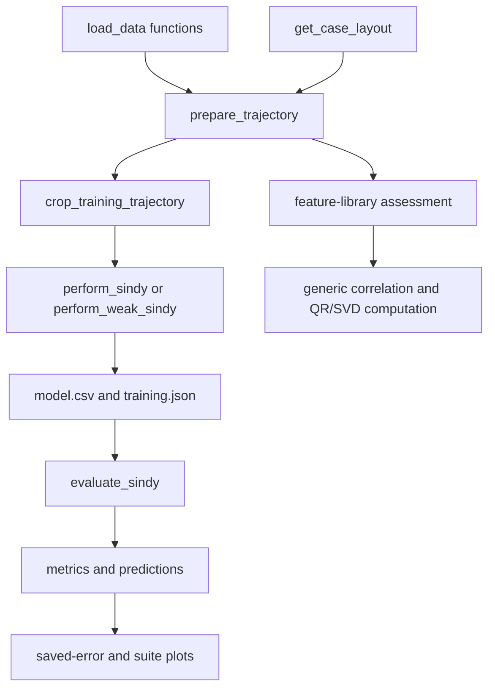

# Bryan cylinder workflow map

This folder adapts the generic SINDy package to the single-cylinder and tandem
LBM datasets. It owns physical constants, channel layouts, recorded-time
windows, model paths and diagnostic metadata.

| Module/folder | Main functions/classes | Responsibility |
| --- | --- | --- |
| `constants.py` | Dataset paths, measured variable names, fixed physical settings | Source of default dataset identities. |
| `input.py` | `load_data_single_cylinder`, `load_data_two_tandem_cylinders` | Load requested named channels as float64 dynamic time and numerical arrays, with shared recorded-acceleration alignment. |
| `preprocessing.py` | `remove_repeated_tandem_records`, `solve_time_duplicates`, compatibility `convert_to_array` import | Remove shared tandem reporting repeats before reconstructing uniform timestamps. |
| `validation.py` | `validate_selection` | Validate requested VR/L/D sets before data loading. |
| [prepare_sindy](prepare_sindy/README.md) | `CaseLayout`, `PreparedTrajectory`, filters, optimizer preparation | Establish the exact states, controls and parameter ordering used by a fit. |
| [compute_sindy](compute_sindy/README.md) | `compute_sindy`, `compute_weak_sindy` | Load/prepare trajectory groups, fit models and save their identities. |
| [model_storage](model_storage/README.md) | Window validation, cropping, path construction and model discovery | Keep fitting and evaluation pointed at the same artifacts. |
| [evaluate_sindy](evaluate_sindy/README.md) | `evaluate_sindy`, frequency/derivative assessments and suite functions | Reconstruct derivatives or integrate saved models and score results. |
| [analysis](analysis/README.md) | Raw/filtering/FFT diagnostics and saved-report summaries | Analyze signals or plot previously saved measurements/metrics. |
| [feature_library](feature_library/README.md) | Wake-library factories and `assess_bryan_feature_library` | Map physical response channels to generic feature libraries and assessments. |
| `plot.py`, `frequency_plot.py` | Time-series/FFT figure builders and common styling | Render prepared arrays; callers own returned figures. |
| [compatibility](compatibility/README.md) | DataFrame adapters and old pickle callables | Keep historical callers and serialized libraries readable. |

## Data and call flow



Measured controls remain in the response library. Constant parameter columns
are appended after controls, with order `V_R`, `L/D`, or `L/D, V_R` according to
the selected parameterization. A tensor library combines the response basis
with the parameter basis. The grouping is one trajectory per individual fit,
all VRs at each L/D for `vr`, all L/Ds at each VR for `lpd`, and the selected
grid for `vr_lpd`.

The processed loaders convert recorded fluid time `t*` to `tau=t*/VR` once.
Tandem loading first checks all ten channels in float64, even for subset requests,
and removes a consecutive row only when its recorded time and every channel
exactly match the previous row. Rounded timestamp collisions with differing
measurements remain. The shared cleanup precedes uniform-time reconstruction
and acceleration alignment; dtype conversion happens after repeat detection.
The reconstructed step is still inferred from the first two retained timestamps.
The shared `_load_processed_data` alignment section in `input.py` is enabled
with `align_recorded_acceleration = True`: recorded hddot uses samples `[1:]`,
while other channels and time use `[:-1]`. This applies to both cylinders and
also trims selections without acceleration. Set the local flag to `False`, or
comment out that entire alignment section, to retain unshifted samples after
the tandem repeat cleanup.
Alignment follows uniform-time reconstruction and precedes filtering or
differentiation; it does not change source CSV files.
Data directories are configured in `constants.py`; this checkout currently
reads them from the sibling `../sindy-viv/data` tree relative to the repository
working directory. Run CLI examples from the repository root.
Preparation/differentiation uses that tau without another rescaling. Fit-window
JSONs and plot bounds use recorded `t*`. Filtering and required derivatives are
computed on full trajectories before cropping. States/controls preserve the
canonical ordering returned by `get_case_layout` throughout fitting and reports.

## Use an API or a command

For an explicit model workflow, call `compute_sindy` with config paths; its
[guide](compute_sindy/README.md) describes return keys and examples. For a matrix
diagnostic without fitting:

```python
from sindy_viv.case_bryan.feature_library.assessment import assess_bryan_feature_library

report = assess_bryan_feature_library(
    "configs/feature_library/polynomial_1.json",
    dynamics_case=3,
    cylinder_type="single",
    vr_list=[3],
    fit_window_case="configs/fit_window/single/sinusoidal.json",
)
print(report["condition_heatmap"])
```

Run these examples from the repository root. The matching CLI is
`script/assess_feature_library.py`; other maintained scripts use the same thin
entry-point pattern. See [script/README.md](../../../script/README.md) for command
families and common selectors.
